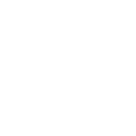

<p align="center">
  <a href="https://git.io/typing-svg">
    
  </a>

  <br>

  <a href="https://git.io/typing-svg">
    
  </a>
</p>

<p align="center">
	<a target="_blank" href="mailto:anwar.ezzirani69@gmail.com"></a>
	&emsp;
	<a target="_blank" href="https://www.linkedin.com/in/anwar-ezzirani/"></a>
	&emsp;
	<a target="_blank" href="https://x.com/AEzzirani"></a>
	&emsp;
	<a target="_blank" href="https://www.instagram.com/anwar_ezzi"></a>
	&emsp;
	<a target="_blank" href="https://discord.gg/4WFDTpHDtw"></a>
</p>

<picture>
  <source media="(prefers-color-scheme: dark)" srcset="https://github.com/AnwarEzzy/AnwarEzzy/blob/output/github-snake-dark.svg" />
  <source media="(prefers-color-scheme: light)" srcset="https://github.com/AnwarEzzy/AnwarEzzy/blob/output/github-snake.svg" />
  
</picture>

---

## 👨🏻‍🎓 About
<p align="left">
Passionate about building practical AI-driven solutions and turning data into meaningful applications.
<br>
Curious by nature, I enjoy exploring new technologies, solving complex problems, and learning by building.
<br>

```python
class AnwarEzzirani:

    def __init__(self):
        # who am I ?
        self.full_name = 'Anwar Ezzirani'
        self.username = '@AnwarEzzy'
        self.role = "Aspiring AI & Machine Learning Engineer"
        self.education = "Final-Year Computer Engineering Student @ EMSI | Data Science & Artificial Intelligence"

        # find me
        self.linkedin = 'linkedin.com/in/anwar-ezzirani/'
        self.twitter = '@AEzzirani'
        self.email = 'anwar.ezzirani69@gmail.com'

        self.areas = ["Machine Learning","Data Science","LLMs","RAG","AI Agents","NLP","Data Engineering"]

    def __str__(self):
        return self.full_name


if __name__ == '__main__':
    me = AnwarEzzirani()
```

## 📊 Profile stat
<br />
<div align="center">
    
</div>

<p>
    
</p>
